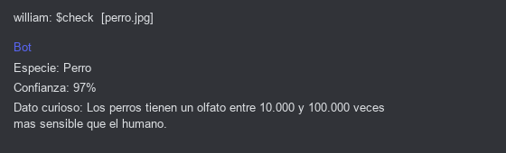

# Bot clasificador de especies animales (Perro / Gato / Caballo / Vaca)

Tareas: 115564 (comando `$check`), 115566 (entrena tu modelo), 115702 / 115703 (modelo en el bot y README).

## Descripcion detallada

Bot de Discord que recibe la foto de un animal y dice de que especie es: **Perro**, **Gato**, **Caballo** o **Vaca**.
Responde con la especie, el porcentaje de confianza y un dato curioso breve. Si la confianza es menor al 60 %,
dice que no esta seguro en lugar de dar una respuesta dudosa.

### Idea y dataset (115566)

- Idea: identificar rapidamente la especie de un animal a partir de una foto.
- Herramienta: [Teachable Machine](https://teachablemachine.withgoogle.com/) (proyecto de imagenes).
- Clases: `Perro`, `Gato`, `Caballo` y `Vaca`.
- Dataset: 45 fotos por clase tomadas de iNaturalist con licencia abierta, y 4 fotos de prueba por clase
  que el modelo no vio durante el entrenamiento.
- Exportar el modelo en formato Keras (`keras_model.h5` y `labels.txt`, con lineas como `0 Perro`).
- Precision medida con las 16 fotos de prueba (`test/<Clase>/`): 13/16 = 81 %.
  Gatos 4/4, caballos 4/4 (uno con confianza 0.50), perros 3/4 (un perro se clasifico como Gato con 0.97)
  y vacas 2/4 (una como Perro con 0.80 y otra como Gato con 0.77).

Nota: los archivos del modelo (`keras_model.h5` y `labels.txt`) se guardan en esta carpeta. Si faltan,
el bot muestra un mensaje claro pidiendo exportarlos desde Teachable Machine.

## Como funciona el modelo

Teachable Machine entrena una red convolucional (MobileNet) por transferencia de aprendizaje.
`model.py` contiene `get_class(model_path, labels_path, image_path)`: redimensiona la imagen a 224x224,
la normaliza a [-1, 1], ejecuta `model.predict` y devuelve la clase con mayor probabilidad y su confianza.

## Instalacion

```
pip install -r requirements.txt
```

Define el token del bot:

```
set DISCORD_TOKEN=TU_TOKEN_AQUI        (Windows cmd)
$env:DISCORD_TOKEN="TU_TOKEN_AQUI"     (PowerShell)
```

## Uso

```
python bot.py
```

En Discord, escribe `$check` adjuntando una imagen. Sin imagen, el bot responde
"Olvidaste subir la imagen :(". Las imagenes recibidas se guardan en `images/`.

`check_solucion.py` contiene solo el comando `$check` basico (tarea 115564).

## Captura



Imagen ilustrativa de una respuesta del bot.

## Licencia

MIT, ver [LICENSE](LICENSE).
